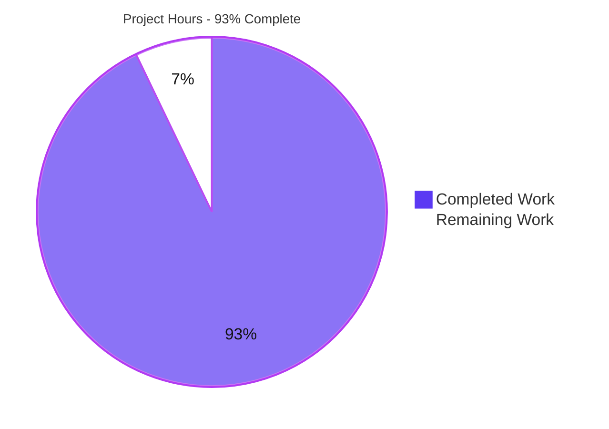

# 1. Executive Summary

## 1.1 Project Overview

Welcome to Blitzy is a single-file Node.js console program. Its entire behaviour is to print the exact string `Welcome to Blitzy` to standard output with no formatting, in the fewest lines that achieve it — one single-line JSDoc summary and one `console.log` statement. It serves a developer or automation runner who runs one command and reads one line. The project also delivers the three-line `README.md` naming the output and the command that produces it. Scope is minimal: two files at the repository root, nothing else.

## 1.2 Completion Status

Completion covers the agreed scope only: the two deliverables it defines and the work to put them into service.

**Formula:** 26.0 h ÷ (26.0 h + 2.0 h) = 92.9% → **93% complete**

| Metric | Hours |
|---|---|
| Total Hours | 28.0 |
| Completed Hours (AI + Manual) | 26.0 |
| Remaining Hours | 2.0 |



## 1.3 Key Accomplishments

- [x] Prints exactly 18 bytes — the greeting plus one line feed — with exit code 0 and empty standard error (`index.js:2`).
- [x] No colour, banner, border, padding, prefix, label, timestamp or markup; the literal starts at byte 0.
- [x] Deterministic across arguments, environments, working directories, and pipes, files or a real console.
- [x] Standard output is the only I/O: nothing read from stdin, the filesystem, the network or the environment.
- [x] Valid CommonJS running from source on a plain Node.js runtime — no manifest, lockfile, dependency or build step.
- [x] `README.md` names the output and the run command, each claim checked against the program.
- [x] Scope held exactly: two tracked files, five insertions and two deletions, every forbidden artifact absent.
- [x] No input, credential or network surface; the workspace's values and secret are read nowhere.

## 1.4 Critical Unresolved Issues

No deliverable is outstanding: 0 of 2 remain open. Five accepted caveats are carried; none blocks release.

| Issue | Impact | Owner | ETA |
|---|---|---|---|
| Cross-release portability unexercised — one Node.js release is installed on the host | Portability is proven on Node.js v22.23.3 only | Maintainer | With the 1.0 h portability check |
| A genuinely closed standard output could not be constructed in this shell | The write-failure path is unmeasured; the nearest reachable cases exit 0 with empty stderr | Platform owner | Not applicable |
| No automated regression gate exists, and none may be added to this repository | A later edit to either file can silently change the output | Maintainer | On every future change |
| The documented command names no working directory | A reader running it outside the repository root sees the runtime's own loader error | Maintainer | Optional |
| No runtime version floor is stated | A much older runtime is untested | Maintainer | Optional |

## 1.5 Access Issues

No access issues identified. Nothing beyond the working tree is needed to run or verify.

| System/Resource | Type of Access | Issue Description | Resolution Status | Owner |
|---|---|---|---|---|
| None | Repository read/write only | Nothing beyond the checked-out working tree is required | Closed — no credential or service is involved | Maintainer |

## 1.6 Recommended Next Steps

1. **[High]** Accept the change: read the two-path diff against the gate result, then merge (1.0 h).
2. **[Medium]** Automate the syntax check and byte-exact gate from outside this repository, which may hold no verification file.
3. **[Low]** Re-run the gate on a second Node.js release to close the portability caveat (1.0 h).
4. **[Low]** Decide whether the run instruction should state its working directory and a runtime floor, departing from the fixed `README.md` content (0.5 h if taken).

# 2. Project Hours Breakdown

## 2.1 Completed Work Detail

| Component | Hours | Description |
|---|---|---|
| Greeting program — exact literal to standard output | 6.0 | The two-line CommonJS program that writes `Welcome to Blitzy` unformatted to standard output, with exit code 0 and empty standard error; verified as exactly 18 bytes (SHA-256 `2DC7E85A…7971951`), with the literal starting at byte 0 and no escape bytes. Trace: the agreed output, its production, and no-format requirements. |
| Comment and line budgets | 2.0 | Exactly one single-line `/** … */` summary and no other comment in the tree; the file is two lines with no trailing blank line, no shebang, no export and no wrapper. Trace: the one-comment and fewest-lines requirements. |
| Runtime and layout conformance | 3.0 | Valid CommonJS with no manifest, lockfile, dependency or build step, running from source on the plain Node.js runtime; both files at the repository root with no subdirectory and no configuration, environment or workflow path. Trace: the runtime, architecture and repository-structure requirements. |
| Runtime operational contract | 8.0 | Determinism verified across 11 argument shapes, a cleared environment, a seeded environment carrying sentinels, three working directories, pipe, redirect and append destinations, closed and piped stdin, and a real interactive console; exit code 0 on every path; standard output as the only I/O. Trace: the determinism, exit-behaviour, input-and-output-discipline and portability requirements. |
| Documentation deliverable | 3.0 | `README.md` as exactly three lines naming the output and the run command, inside the five-line cap with no forbidden section, and with every claim checked against the program: the documented command resolves to the entry file, and its quoted string matches the emitted literal character for character. Trace: the readme requirements and the documentation row of the file plan. |
| Scope conformance and absence audit | 2.5 | Exactly two tracked files; the change adds one file and updates one in place; 43 named forbidden paths probed absent; both committed blobs LF-only with no carriage returns; the working tree byte-identical after every run. Trace: the in-scope, out-of-scope, smallest-diff and file-plan requirements. |
| Security posture | 1.5 | No input, credential, storage or network surface: no credential-shaped literal, no injection sink, no URL-embedded credential, and no environment or secret read anywhere. Trace: the security-applicability requirement. |

**Total completed: 26.0 h**

## 2.2 Remaining Work Detail

| Category | Hours | Priority |
|---|---|---|
| Acceptance review of the delivered change — read the two-path diff against the recorded gate result, then merge | 1.0 | High |
| Cross-release portability spot-check — run the published gate once on a second Node.js release | 1.0 | Low |
| **Total** | **2.0** | |

## 2.3 Hours Basis, Confidence and Traceability

Every hour above traces to a named requirement of the agreed scope or to putting the deliverable into service; nothing outside that scope is counted, and the pre-existing commit that introduced the generated readme contributes no hours, because the delivery begins with the change that replaced it.

The completed figure reflects the size of the change (five insertions and two deletions in two files) together with the verification effort the change carried: byte-level conformance of both files, a byte-exact output gate with positive and negative controls, determinism across four named dimensions, argument and environment stress cases, repeat and concurrent runs, side-effect and secret-leak probes, and the absence audit of 43 forbidden paths. Confidence is **high** for items 1–2 and 5–7, whose evidence is byte-level and reproducible, and **medium** for item 3's portability half, where only one runtime release was available to exercise.

The remaining 2.0 h contains no product work: both deliverables exist at their agreed contents, every recorded requirement is met, and nothing is partially built. The 1.0 h acceptance review is the human sign-off any release needs, and the 1.0 h portability check is the single residual of the portability requirement — the file uses nothing newer than core CommonJS, so the residual is a confidence gap rather than a known defect. No deployment, packaging, migration or configuration work remains, because the program is run in place and is not packaged or published.

**Integrity check:** 26.0 h (Section 2.1) + 2.0 h (Section 2.2) = 28.0 h total; 26.0 ÷ 28.0 = 92.9%, reported as 93% in Sections 1.2, 7 and 8, with the Section 7 chart carrying the same 26.0 completed and 2.0 remaining.

# 3. Test Results

| Area / Category | Framework | Tests | Passed | Failed | Coverage | What This Proves |
|---|---|---|---|---|---|---|
| Byte-exact output gate and syntax check | Node.js v22.23.3 CLI gate with `cmd`/bash byte capture | 13 | 13 | 0 | n/a — no coverage tooling exists or may be added | Running `index.js` writes exactly 18 bytes — the 17-character greeting plus one line feed — with exit code 0 and an empty standard error, and the file parses cleanly |
| Delivered source and documentation text | Byte- and line-level assertions (PowerShell) | 14 | 14 | 0 | n/a | `index.js` is exactly its two agreed lines and `README.md` exactly its three; committed blobs are LF-only with no carriage return, no byte-order mark, no shebang and no trailing blank line |
| Source-quality and secret scan | Static pattern scan over both files | 9 | 9 | 0 | n/a | One comment and no JSDoc tags, no placeholder or TODO markers, no module, filesystem, network or environment reference, and no credential-shaped literal |
| Scope, provenance and forbidden-artifact sweep | Filesystem probes plus git queries | 11 | 11 | 0 | n/a | Exactly two tracked files, the change adds one file and updates one in place, 43 named forbidden paths are absent and the working tree is clean |
| Runtime determinism — arguments, environment, working directory, stdin, destination | Bash harness on Git for Windows | 21 | 21 | 0 | n/a | Identical 18 bytes and exit code 0 across 11 argument shapes, a cleared environment, a poisoned environment with secret sentinels, foreign/empty/Unicode working directories, closed and piped stdin, pipe, redirect, append, a write-failure device and a closed error stream |
| Repeat and concurrent stability | Bash harness | 2 | 2 | 0 | n/a | Ten sequential runs produce one distinct output and ten simultaneous runs are byte-identical with no interleaving, truncation or partial line |
| Documented user path, isolation and negative controls | Bash harness plus filesystem probes | 5 | 5 | 0 | n/a | The command extracted from `README.md` produces the documented output, an empty working directory gains no file, and a 19-byte variant, an ANSI-coloured variant and a missing file are each rejected — so a pass is meaningful |
| Repository integrity and gate posture after every run | Filesystem snapshot, npm CLI, git status | 7 | 7 | 0 | n/a | The working tree is byte-identical before and after all runs, nothing was written inside the repository, and `npm test` fails only for want of a manifest — by design, since no test suite may be added |

**Totals: 82 checks executed, 82 passed, 0 failed.** Every count above was observed on the delivered revision; the runtime is Node.js v22.23.3.

**Not Covered**

- **Cross-release portability.** Exactly one Node.js release is installed on the host, so the program was not exercised on a second release. The file uses nothing newer than core CommonJS, but a human should run the published gate once on the release they intend to target.
- **A genuinely closed standard output.** The shell used for capturing reopens the descriptor, so this failure path could not be constructed. The nearest reachable cases were exercised instead — a write-error device, a consumer that closes the pipe immediately, and a closed error stream — and all three exit 0 with an empty standard error.
- **No automated suite re-runs any of this.** By the agreed scope the repository carries no test suite, manifest or gate, so the byte-exact check must be invoked by hand. Before release, run the published per-change gate on the exact commit being shipped.

# 4. Runtime Validation & UI Verification

Every line below was exercised on the delivered revision, from the repository root unless stated otherwise.

- ✅ **Startup and single execution path** — `node index.js` prints one line and exits; the same run from a foreign working directory by absolute path is byte-identical.
- ✅ **Console rendering on a real terminal** — an interactive console with `process.stdout.isTTY` true rendered one plain, unformatted line `Welcome to Blitzy` in default cell attributes, returned the prompt and reported exit code 0.
- ✅ **Exit status** — 0 on every exercised invocation: plain, piped under a failing-pipe check, redirected, appended, written to a failure device, with a closed error stream, with a consumer exiting immediately, and with closed stdin.
- ✅ **Argument handling** — 11 shapes (help and version flags, positionals, shell metacharacters, injection payloads, Unicode, an 8 000-character argument and an empty string) left the output and exit code unchanged and produced no usage text.
- ✅ **Environment independence** — a cleared environment, the workspace's own variables and secret, hostile temp, timezone and locale values, and an unreachable proxy all produced identical output; no value reached either stream.
- ✅ **Working-directory independence and portability** — absolute-path runs from three other directories, including one containing spaces and non-ASCII characters, with nothing installed, built or configured.
- ✅ **Output destinations** — file, pipe, append, the null device and a write-failure device; where captured, exactly 18 bytes each time.
- ✅ **Side-effect freedom** — no file, socket, listener or lingering process; the working tree is byte-identical after every run.
- ⚠ **Partial — cross-release portability:** verified on Node.js v22.23.3, the only release present on the host.
- ⚠ **Partial — genuinely closed standard output:** the capturing shell reopens the descriptor, so this path could not be constructed; the nearest reachable failure destinations all exit 0 with an empty standard error.

No browser-rendered surface was exercised because none exists: the deliverable has no page, route, server or HTTP surface, and its whole behaviour is one console write. The only user-facing surface is the console, which was driven directly as above.

# 5. Compliance & Quality Review

## 5.1 Compliance Matrix

| Deliverable | Benchmark | Status | Evidence |
|---|---|---|---|
| `index.js` — exact literal on standard output | Output fidelity | ✅ Pass | 18 bytes `Welcome to Blitzy` + LF, SHA-256 `2DC7E85A…7971951`, exit 0, empty standard error |
| `index.js` — no format applied | Output formatting | ✅ Pass | 0 escape bytes, literal at byte 0, default console cell attributes on a real terminal |
| `index.js` — two lines carrying one JSDoc summary | Source and comment budget | ✅ Pass | 2 content lines; the tree holds exactly one comment and no JSDoc tag |
| `index.js` — exit code 0, no error path | Exit behaviour | ✅ Pass | 0 on every exercised path, including failure destinations; no error-handling construct exists |
| `index.js` — valid CommonJS, no build step | Portability and run contract | ⚠ Pass with a stated caveat | Syntax check exit 0, runs from source with no manifest; one runtime release exercised |
| `index.js` — determinism across arguments, environment, working directory, terminal vs pipe | Determinism | ✅ Pass | 11 argument shapes, cleared and seeded environments, three working directories, pipe, file and console |
| `index.js` — standard output is the only I/O | Input/output discipline | ✅ Pass | Closed and piped stdin leave output unchanged; no process, filesystem, network or environment reference |
| `index.js` — no placeholder, dead or unfinished code | Code completeness | ✅ Pass | 0 placeholder markers, no commented-out code, no stubbed or unreachable branch |
| `README.md` — three lines inside the five-line cap, no forbidden section | Documentation budget | ✅ Pass | 3 lines; 0 hits for contributing, license, testing, deployment, architecture or contents sections |
| `README.md` — names the output and the run command, truthfully | Documentation accuracy | ✅ Pass | The command extracted from the file, run verbatim, produced the documented output |
| Scope — two files, smallest diff, forbidden artifacts absent | Scope discipline | ✅ Pass | 2 tracked files; +5/−2 across 2 paths; 43 forbidden paths absent |
| Security — no input, credential or network surface | Security baseline | ✅ Pass | Credential, input-validation and injection checks clean; workspace variables and secret read nowhere |

## 5.2 AAP & Rule Divergences and Gaps

| # | What the AAP/Rule Required | What Was Delivered Instead | Why It Diverged | Impact | Remediation |
|---|---|---|---|---|---|
| 1 | The two files are created, and `README.md` "does not exist" — the repository root "holds no files today" | `README.md` was updated in place: `M README.md` with 3 insertions and 2 deletions, replacing a pre-existing 40-byte two-line generated readme; `index.js` was created (`A index.js`) | The starting tree already tracked a generated two-line `README.md`, so the agreed final contents had to be reached by replacing it — creating the file from nothing was not possible, and the delivered contents match the agreement exactly | The diff carries 2 deletions that an "addition only" change would not; the delivered content is unaffected | None — the delivered contents are exactly the agreed three lines; the wording of the starting state is superseded by the repository's history |
| 2 | The runtime is cited at a POSIX system path | The work ran with `node` resolved through the host's executable path (Windows), Node.js v22.23.3 | The citation came from a POSIX description of the environment; the working environment is a Windows host, whose installed runtime is the same version and is the one the toolchain provides | None on the deliverable; a reader rebuilding the environment from the citation alone would look in the wrong place | None required — the version value the requirement carries holds; note the host path if the environment is ever rebuilt from documentation |
| 3 | "Use as less lines as possible by optimizing token usage" | `index.js` is two lines: a one-line JSDoc summary and the statement | The same request mandates a one-line JSDoc summary, which cannot be folded into the statement; the comment requirement is not tradeable against minimality, so two lines are the fewest that satisfy both | One extra line in the source file, and a slightly larger diff | None — this is the sanctioned reading of the request; one line would drop a mandated comment |
| 4 | Verification machinery is normally expected to accompany delivered code | No test suite, test file, lockfile, manifest or dependency was added; the published byte-exact run is the whole gate | The request explicitly forbids a test suite, test files, a lockfile and any dependency, and the plan forbids a manifest — the higher-ranked instruction sets the gate | Nothing re-runs the check automatically; the output string and entry file are protected only by that manual gate | None in this repository; a team that wants automation should run the gate from outside it (Section 9) |
| 5 | Runtime validation is normally exercised through a browser and a rendered interface | No browser or visual validation was performed for the documentation deliverable | There is no page, route, server or HTTP surface to render — the product is a console program — so the documented command's runtime was exercised directly instead | None; the deliverable's only runtime behaviour is fully exercised | None — no browser-rendered surface exists |
| 6 | Run instructions should state the required tool versions and the directory commands run from | `README.md:3` states "Requires Node.js" with no version floor and names `node index.js` without a working directory | The agreed three-line content is fixed as the acceptance criterion and the request caps the readme at five lines; adding either value departs from the fixed content, and no manifest exists to carry a version | A reader running the command outside the repository root sees the runtime's loader error, and an older runtime is untested | Decide whether to reopen the readme content (0.5 h); otherwise run the command from the repository root |
| 7 | One line-ending and formatting convention for the repository | The two deliverables carry different working-tree line endings — `README.md` LF, `index.js` CRLF — and no `.gitattributes` was added | The instruction covering `README.md` required its working-tree bytes to contain no carriage returns, while creating any further file (including `.gitattributes`) is forbidden; the host's checkout convention differs from the one demanded for that file | Committed history is unaffected (both blobs are LF-only), but a contributor with a different checkout convention can see whitespace-only churn | None — do not add `.gitattributes`; commit LF-only blobs and avoid reformatting commits |

**Divergence 1 — `README.md` updated rather than created.** The agreement describes both files as new and states that the repository root holds no files, but the base commit already tracked a `README.md` holding two generated lines — a title and an attribution. The delivered change replaced those lines in place, visible in the history as three insertions and two deletions against the generated text. The final content is exactly the three agreed lines, character for character, so nothing about the deliverable is wrong; the agreed narrative simply misdescribes the starting tree. No action is required unless tooling regenerates that two-line readme, in which case the same in-place replacement should be expected.

**Divergence 2 — runtime path citation.** The agreement cites the runtime at a POSIX system path; the work ran with `node` resolved through the host's executable path, on Node.js v22.23.3. The version — the value the requirement actually carries — matches exactly, and no delivered file references a runtime path at all, so nothing in the repository depends on the citation. Treat this as an environment-documentation artefact of a plan written for a POSIX host and executed on a Windows host: anyone rebuilding the environment should install Node.js 22.x and confirm `node --version` reports v22.23.3 rather than searching for the cited path.

**Divergence 3 — two lines instead of one.** Taken alone, "use as less lines as possible" would yield a single line holding only the statement. The same request, however, mandates a one-line JSDoc summary, and the plan settles the tension by declaring that comment non-tradeable. The delivered file is therefore the two lines that satisfy both instructions, and the comment is the only one in the tree. The impact is one line of source and a marginally larger diff; a human who prefers the strict one-line reading must accept that the mandated comment disappears, and should treat that as a decision about the requirement rather than a defect in the code.

**Divergence 4 — no test suite, manifest or dependency.** The repository carries no verification instrument of its own: no manifest to host a test script, no runner, no lockfile, no dependency and no workflow. This is the direct consequence of the request's prohibitions, not an omission — and the published byte-exact run, which checks the exit code, the exact 18 output bytes, their SHA-256 and an empty standard error, served as the whole gate and passes. The practical consequence for the reader is that nothing re-checks this after an edit. If that matters to the team, the check belongs outside the repository, in whatever continuous-integration system consumes it, precisely so this repository stays as agreed.

**Divergence 5 — no browser-rendered validation.** The general expectation that delivered behaviour is exercised through its user interface was not met for the documentation deliverable, because there is no interface to exercise: no page, no route, no server, no HTTP surface, no stylesheet and no component exists anywhere in the tree. The user-facing behaviour that does exist — the console line — was exercised on a real terminal as well as through pipes and files, and the run instruction in the readme was executed verbatim rather than sampled. No action follows; any future browser-based validation would need a web surface that this product does not have.

**Divergence 6 — run instruction states no version floor or directory.** `README.md:3` reads "Requires Node.js; run `node index.js`". Two review standards would prefer a version floor and the directory the command resolves from, and neither was added, because the agreed three-line content is fixed as the acceptance criterion and the request caps the file at five lines. The consequence is practical, not functional: run from anywhere other than the repository root and the runtime reports its own loader error, while the program's output is working-directory independent once it is given a resolvable path. A maintainer who wants either value stated must reopen the readme content, which is a 0.5 h decision rather than a fix.

**Divergence 7 — mixed working-tree line endings.** `index.js` carries CRLF in the working tree while `README.md` carries LF, and no `.gitattributes` was added to normalise them, because creating any further file is forbidden and the instruction covering the readme required its working-tree bytes to contain no carriage returns. Both committed blobs are LF-only with no carriage return, and the output is byte-identical either way, so the deliverable is unaffected — this is a hygiene matter. A contributor whose checkout convention differs can nonetheless see whitespace-only churn in the readme; the guidance is to commit LF-only blobs and avoid reformatting, and never to add a `.gitattributes` file.

No other departure from the agreed plan or the request's rules was identified; the remaining settled decisions on record are the choices embodied in divergences 4 and 7, neither of which requires human work.

# 6. Risk Assessment

| Risk | Category | Severity | Probability | Mitigation | Status |
|---|---|---|---|---|---|
| No automated regression gate exists, and none may be added inside this repository, so a later edit to either file could silently change the output or break the entry point | Technical | Medium | Medium | Run the published byte-exact gate — syntax check plus the 18-byte, SHA-256 and empty-error-stream assertions — after every change; drive it from a job outside the repository | Open — accepted under the agreed scope |
| Cross-release portability is unproven: exactly one Node.js release is installed, so the program was exercised on v22.23.3 only | Technical | Low | Low | Run the published gate once on a second release before targeting it (1.0 h) | Open |
| A write failure on standard output — a consumer that closes the pipe, or an unavailable console — is unhandled by design, and a genuinely closed descriptor could not be constructed to measure it | Technical | Low | Low | None required: a write-error device and an immediately exiting consumer both leave exit code 0 with an empty error stream; adding a handler would depart from the agreed scope | Accepted |
| The two deliverables carry different working-tree line endings and no `.gitattributes` may be added, so a contributor with a different checkout convention can see whitespace-only churn | Technical | Low | Medium | Commit LF-only blobs, avoid reformatting commits, and confirm the committed bytes rather than the working tree | Monitored |
| The documented command names no working directory, so a reader running it from elsewhere sees the runtime's own module-loader error rather than the greeting | Operational | Low | Medium | Run the command from the repository root, or path the entry file absolutely; state the directory if the readme content is ever reopened | Accepted |
| No runtime version floor is stated, so a much older runtime is untested | Operational | Low | Low | Install and record a supported Node.js 22.x line; state a floor only if the readme content is reopened | Accepted |
| The host workspace carries provider keys and one secret that the program reads nowhere; a future change must not begin reading them | Security | Medium | Low | Keep the program free of environment and credential reads and re-run the absence and secret-leak checks on any change | Monitored |

No integration risk applies: the deliverable has no endpoint, service, data store, queue, webhook, outbound call or third-party dependency, so there is no external contract that can break.

# 7. Visual Project Status


**Completed 26.0 h / Remaining 2.0 h / Total 28.0 h — 93% complete.**

| Measure | Value |
|---|---|
| Completed work (Dark Blue `#5B39F3`) | 26.0 h |
| Remaining work (White `#FFFFFF`) | 2.0 h |
| Total project hours | 28.0 h |
| Completion | 93% |

Remaining hours per category, as itemised in Section 2.2:

| Category | Hours | Priority |
|---|---|---|
| Acceptance review of the delivered change | 1.0 | High |
| Cross-release portability spot-check | 1.0 | Low |
| **Total** | **2.0** | |

Priority distribution of the remaining work: **1.0 h High**, **0 h Medium**, **1.0 h Low**. The completed work is entirely in the delivered files and their verification: the greeting program and its output contract, the comment and line budgets, the runtime and layout conformance, the operational contract, the readme deliverable, the scope and absence audit, and the security posture — 26.0 h, none of it deferred.

# 8. Summary & Recommendations

**What was delivered.** The project is a two-file Node.js console program: `index.js`, which writes the exact string `Welcome to Blitzy` to standard output unformatted and exits 0, and `README.md`, which names that output and the single command that produces it. The change is five insertions and two deletions across those two paths — the smallest footprint that satisfies the agreed requirement set, with no manifest, dependency, lockfile, build step, configuration or service anywhere in the tree. Both files are byte-verifiable artefacts: `index.js` emits exactly 18 bytes, the 17 characters of the greeting plus one line feed, and its committed blob is 79 bytes of LF-only text; `README.md` is three LF-only lines inside the five-line cap.

**What was exercised to prove it.** The output contract was measured rather than assumed: 82 checks ran against the delivered revision and all 82 passed, covering the syntax check, the byte-exact stdout gate with its negative controls, both files' exact text and committed bytes, the comment and line budgets, source-quality and secret scans, the scope and forbidden-artifact sweep, determinism across argument shapes, environments, working directories, stdin and destinations, repeat and concurrent runs, and the documented user path. On a real interactive terminal the program rendered one plain line with the terminal flag true and exit code 0. Every requirement in the agreement is accounted for: 19 of 19 are met, with one caveat noted below.

**Completion status.** The agreed scope is complete and the delivery stands at **93% complete** — 26.0 h of 28.0 h, with 2.0 h remaining. Nothing is partially built and no deliverable is outstanding; both files exist at exactly the contents the agreement fixes and every requirement in that agreement carries a verdict. The remaining 2.0 h is not product work: 1.0 h is the human acceptance review that any release needs, and 1.0 h is a portability spot-check on a second Node.js release, since only Node.js v22.23.3 is installed on this host and the file's "any release able to run a .js file" claim was therefore exercised on one runtime.

**Critical path to production.** The program is run in place — it is not packaged, published or deployed — so there is no build or release pipeline to complete. The path is short and entirely human: review the two-path diff against the recorded gate result and merge (1.0 h), then optionally re-run the published gate on the Node.js release the consumers will use (1.0 h). Two decisions are worth taking deliberately rather than by default: whether the run instruction should state its working directory and a runtime floor, which would depart from the fixed three-line readme content; and whether to automate the gate from outside this repository, since no verification file may be added inside it.

**Production readiness.** Ready as written, with accepted caveats. The deliverable is a zero-dependency CommonJS program whose entire behaviour is one 18-byte write, verified deterministic across arguments, environment, working directory and output destination, with no side effects, no error path, no attacker-reachable surface and no secret dependency. The residual exposure is procedural rather than functional: nothing re-runs the byte-exact check automatically, so each future edit must be verified by hand with the published gate, and any assurance automation belongs outside the repository. A reader adopting this codebase can rely on the greeting, its exact bytes and its exit status, and can treat the 2.0 h of remaining work — the acceptance review and the portability spot-check, with the caveats listed in Section 1.4 — as the whole of what stands between the delivered code and sign-off.

# 9. Development Guide

### System Prerequisites

- **Runtime:** Node.js 22.x (any release able to execute a CommonJS `.js` file). Verified on **v22.23.3** with npm 10.9.9 — `node --version` → `v22.23.3`.
- **Operating system:** any; no native module, platform-specific command or path assumption exists.
- **Hardware:** none beyond a working shell. The program writes one line and exits.
- **Not required:** no database, message queue, cache, container, port, credential, API key or service.
- **Working directory:** run every command below from the repository root, where both files live.

### Environment Setup

There is nothing to configure. The program reads no environment variable, no configuration file and no secret; it behaves identically under a cleared environment, the workspace's own variables, hostile temp/timezone/locale values and a dead proxy. No virtual environment, session or `.env` file is involved.

### Dependency Installation

**No installation step exists.** The repository declares no manifest, no lockfile, no dependency and no `node_modules`, so nothing is fetched, built or linked — the program runs from source. Do not run `npm install`; it would create a manifest the agreed scope forbids.

### First Run

```bash
# from the repository root
node index.js
```

Expected output — one line, no formatting:

```
Welcome to Blitzy
```

The process exits with code 0 and writes nothing to the error stream. There is no server to start and no long-running process, so nothing needs stopping afterwards. Running the file by absolute path from any other directory produces the same line.

### Verification

The whole gate is the byte-exact check below. It is the project's entire verification instrument — no test suite, linter or coverage gate exists, by the agreed scope — so run it after every change.

```powershell
# per-change gate: exit code, exact 18 bytes, published SHA-256, empty error stream
cmd /c "node index.js > $env:TEMP\blitzy_out.txt 2> $env:TEMP\blitzy_err.txt"
$rc = $LASTEXITCODE
$b = [IO.File]::ReadAllBytes("$env:TEMP\blitzy_out.txt")
$ok = ($rc -eq 0) -and ($b.Length -eq 18) -and `
      ((Get-FileHash "$env:TEMP\blitzy_out.txt" -Algorithm SHA256).Hash -eq '2DC7E85A734DE043468D7BEB8EE5294E0C04440F23FD89B69FD8EA0EE7971951') -and `
      ((Get-Item "$env:TEMP\blitzy_err.txt").Length -eq 0)
if ($ok) { 'PASS' } else { 'FAIL' }
```

```powershell
# quick checks
(node index.js) -eq 'Welcome to Blitzy'   # True
node --check index.js                     # syntax only; no output, exit code 0
(Get-Content index.js).Count              # 2
(Get-Content README.md).Count             # 3
```

Capture bytes with `cmd` or bash redirection, as above. PowerShell's `>` re-encodes native output to UTF-16LE with CRLF and will report 40 bytes instead of the program's 18 — that is the shell, not the program.

The gate has been validated with negative controls, so a pass is meaningful: a 19-byte variant (greeting plus a full stop), an ANSI-coloured variant (27 bytes with escape bytes) and a missing file (non-zero exit, empty stdout) are each rejected by it.

### What to Check After Any Edit

1. `node --check index.js` — exit code 0.
2. The per-change gate above — `PASS`.
3. `(Get-Content index.js).Count` → 2 and `(Get-Content README.md).Count` → 3, with the agreed contents unchanged line for line.
4. `git status --porcelain -uall` — no unexpected file appears; the tree should hold only `index.js` and `README.md`.
5. If the readme changed, extract its documented command and run it verbatim from the repository root; it must produce the same 18 bytes.

### Example Usage

```bash
# run from the repository root
node index.js                      # prints: Welcome to Blitzy   (exit 0)

# the same program by absolute path, from anywhere
node /path/to/repository/index.js

# capture and inspect the exact bytes
node index.js > out.txt
wc -c out.txt                      # 18
od -c out.txt                      # W e l c o m e   t o   B l i t z y \n

# pipe into another program
node index.js | grep -q '^Welcome to Blitzy$' && echo matched

# arguments are inert by design (no argument handling exists)
node index.js --help               # prints: Welcome to Blitzy
```

### Troubleshooting

| Symptom | Cause | Resolution |
|---|---|---|
| `npm test` fails with `npm error code ENOENT … Could not read package.json` | No manifest exists, by design; there is no test suite to run | Expected — use the per-change gate above as the acceptance check |
| A captured output file is 40 bytes instead of 18 | The capture went through PowerShell's `>` operator, which re-encodes native output to UTF-16LE with CRLF | Capture with `cmd /c "node index.js > file"` or bash redirection |
| `Cannot find module …` | The command was run from outside the repository root | Run it from the root, or pass an absolute path to `index.js`; the program itself is working-directory independent |
| A `\\?\`-prefixed absolute path is rejected with `EISDIR: … lstat 'C:'` | The Node.js module loader rejects extended-length paths for any script, including a trivial control script | Use an ordinary absolute path |
| A pseudo-terminal wrapper prints extra escape sequences or its own assertion message | The wrapper injects its own terminal control and diagnostics | Capture through a pipe, a file or a real console — those are exactly 18 escape-free bytes |
| Node exits non-zero before the program runs with `--not-a-real-flag is not allowed in NODE_OPTIONS` | A malformed option in `NODE_OPTIONS` is rejected by the runtime's own CLI parser | Unset or correct `NODE_OPTIONS`; the program never sees this failure |
| An untracked `blitzy\` directory appears in the checkout | Empty directories created by the checkout tooling: `screenshots\` and `screen_recordings\` | Harmless; each holds no file and neither is part of the change |

# 10. Appendices

### A. Command Reference

| Purpose | Command (run from the repository root) |
|---|---|
| Run the program | `node index.js` |
| Run by absolute path from anywhere | `node /absolute/path/to/index.js` |
| Syntax check | `node --check index.js` |
| Per-change gate (exit code, 18 bytes, SHA-256, empty error stream) | `cmd /c "node index.js > $env:TEMP\blitzy_out.txt 2> $env:TEMP\blitzy_err.txt"` then the assertion block in Section 9 |
| Quick text check | `(node index.js) -eq 'Welcome to Blitzy'` |
| Inspect the exact bytes | `node index.js | wc -c` → 18 |
| Line counts | `(Get-Content index.js).Count` → 2; `(Get-Content README.md).Count` → 3 |
| Confirm nothing extra was added | `git status --porcelain -uall` |
| List the tracked files | `git ls-files` |

### B. Port Reference

No port is bound, opened or listened on. The program creates no socket, starts no server and leaves no process running; a listener check before and after a run is identical.

### C. Key File Locations

| Path | Role |
|---|---|
| `index.js` | The entire program: one single-line JSDoc summary and one statement writing the greeting to standard output |
| `README.md` | The three-line readme naming the output and the command that produces it |
| `blitzy/screenshots`, `blitzy/screen_recordings` | Empty directories created by the checkout tooling; they hold no file and are not part of the change |

### D. Technology Versions

| Component | Version | Notes |
|---|---|---|
| Node.js | v22.23.3 | The runtime the program was verified on; nothing newer than core CommonJS is used, and no version is pinned because no manifest exists to carry one |
| npm | 10.9.9 | Present on the host; not used by the project — no install step exists |
| JavaScript module system | CommonJS | A `.js` file with no controlling `package.json` evaluates as CommonJS |
| Operating system | Windows Server 2022 (verification host) | Any OS; no platform-specific code, command or path |

### E. Environment Variable Reference

The program reads **no** environment variable, and no environment-variable configuration exists or may be added. The host workspace carries variables and one secret that the program never consults; output is identical with them present, seeded with sentinels, or absent entirely. No `.env` file, `.nvmrc` or configuration template exists.

### F. Developer Tools Guide

| Tool | Purpose here | Notes |
|---|---|---|
| `node` | Run and syntax-check the program | The only required tool |
| `git` | Inspect the two-file history and confirm the tree is clean | `git ls-files` lists exactly `index.js` and `README.md`; `git diff --numstat HEAD~2..HEAD` shows `2 0 index.js` and `3 2 README.md` |
| `cmd` / bash | Byte-exact capture of standard output | Use these rather than PowerShell's `>` operator, which re-encodes |
| `sha256sum` / `Get-FileHash` | Confirm the 18 output bytes and the published hash | Reference hash: `2DC7E85A734DE043468D7BEB8EE5294E0C04440F23FD89B69FD8EA0EE7971951` |
| `git status --porcelain -uall` | Confirm no stray file was written | Expected: no output |

### G. Glossary

| Term | Meaning |
|---|---|
| AAP | The agreed plan of record this delivery was measured against; referenced in Section 5.2 |
| Byte-exact gate | The project's whole verification: run the program, assert exit code 0, 18 output bytes, the published SHA-256 and an empty error stream |
| CommonJS | The module convention a `.js` file follows when no `package.json` declares otherwise |
| CRLF / LF | Carriage-return-plus-line-feed / line-feed line endings; the committed blobs are LF-only, and the output always ends with a single LF |
| JSDoc summary | The one-line `/** … */` comment at `index.js:1` |
| LF (0x0A) | The single line feed the runtime appends to the greeting, making the output 18 bytes |
| Path-to-production | Work needed to put the deliverable into service; here, only running the program in place |
